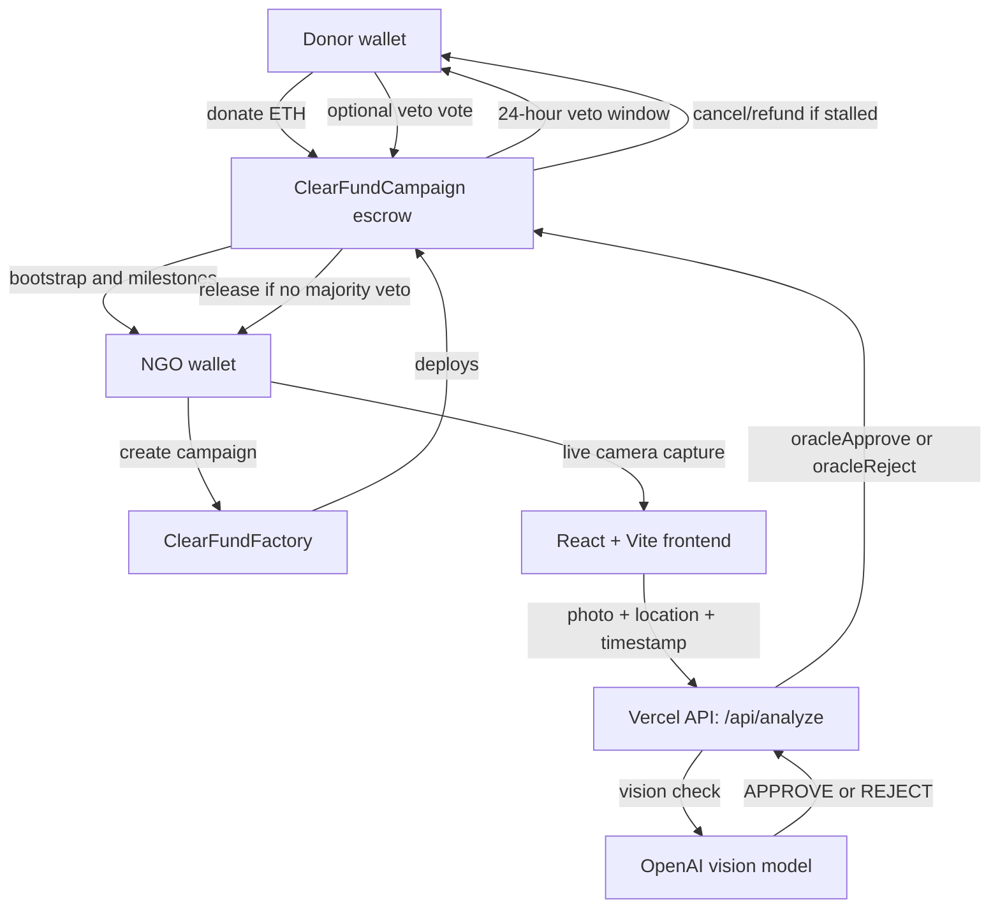

# ClearFund

ClearFund is a milestone-based donation escrow app on Ethereum Sepolia.
Donors fund NGO campaigns, but funds do not go straight to the NGO. ETH stays
inside a campaign smart contract and is released in stages only after milestone
evidence is submitted, checked by an AI oracle, and survives a 24-hour donor
veto window.

The goal is simple: make donations accountable without forcing donors to vote
on every small step.

## What ClearFund Solves

Traditional donation platforms ask donors to trust that money will be used
properly. ClearFund moves that trust into a transparent workflow:

- Donations are held in on-chain escrow.
- NGOs receive only a small bootstrap release when the campaign starts.
- Remaining funds unlock milestone by milestone.
- Milestone evidence must come from live camera capture and browser location.
- The AI oracle gives a first-pass approval or rejection.
- Donors get a 24-hour veto window before funds are released.
- If the NGO misses a milestone deadline, donors can cancel and claim refunds
  from the remaining escrow.

## Core Features

| Feature | How it works |
| --- | --- |
| On-chain escrow | Every campaign is its own smart contract holding donated ETH. |
| Milestone payouts | Funds are split across NGO-defined milestones. |
| Bootstrap release | A 1-15% bootstrap tranche is released when fundraising passes the start threshold. |
| Live evidence | NGOs must capture evidence through the browser camera. No file upload field is exposed. |
| Location permission | Browser geolocation is requested during evidence capture. No manual location input is used. |
| AI oracle | The Vercel API route sends the live photo, location, and milestone text to OpenAI, then signs the approval or rejection transaction. |
| Donor veto | Donors can veto during the 24-hour review window. Non-voters count as yes when the window ends. |
| Majority rule | A milestone is rejected only if veto votes become a strict donor majority. |
| Refund path | If the campaign is cancelled or fundraising fails, donors can claim proportional refunds from the remaining balance. |
| RainbowKit wallet support | Wallet connection uses RainbowKit dark mode for browser, Safari, and mobile wallet flows. |

## Product Flow

1. NGO creates a campaign with a title, description, fundraising goal, campaign
   deadline, bootstrap percent, and 2-5 milestones.
2. Donors connect a wallet and donate ETH on Sepolia.
3. When the bootstrap threshold is reached, the NGO starts the campaign.
4. The campaign contract releases the bootstrap tranche to the NGO.
5. For each milestone, the NGO opens the live camera, allows location access,
   captures a fresh photo, and submits the milestone on-chain.
6. The frontend sends the photo, location, capture timestamp, campaign address,
   and milestone id to `frontend/api/analyze.js`.
7. The oracle checks that the campaign is registered, rejects stale evidence,
   asks the model for an `APPROVE` or `REJECT`, then calls the campaign contract.
8. If approved, the milestone enters a 24-hour veto window.
9. Donors may vote no by calling `vetoMilestone`.
10. If veto votes are not a strict majority after 24 hours, anyone can call
    `executeMilestone` to release the tranche.
11. If a strict majority veto happens, the milestone is rejected. The NGO may
    resubmit before the deadline. If the deadline is missed, donors can cancel
    and refund the remaining escrow.

## Architecture



## Folder Structure

The repo is intentionally small. There are only two main folders:

```txt
ClearFund/
  contracts/
    ClearFundCampaign.sol
    ClearFundFactory.sol

  frontend/
    api/analyze.js
    assets/
    components/
    blockchain.ts
    index.css
    index.html
    main.tsx
    package.json
    tsconfig.json
    vercel.json
    vite.config.ts
```

No build output, test files, generated folders, private keys, or `.env` files
belong in the public repo.

## Smart Contracts

### `ClearFundFactory.sol`

The factory deploys campaigns and keeps the campaign registry.

Main responsibilities:

- Store the oracle wallet address.
- Validate campaign inputs.
- Deploy `ClearFundCampaign`.
- Track all deployed campaign addresses.
- Track campaigns created by each NGO wallet.

### `ClearFundCampaign.sol`

Each campaign contract holds the donated ETH and controls the lifecycle.

Campaign states:

```txt
Fundraising -> Active -> Completed
                  |
                  v
              Cancelled
```

Milestone states:

```txt
Pending -> Submitted -> InVeto -> Approved
                    |
                    v
                 Rejected
```

Important contract actions:

| Function | Caller | Purpose |
| --- | --- | --- |
| `donate()` | Donor | Sends ETH into escrow. |
| `startCampaign()` | NGO | Starts the campaign and releases bootstrap funds. |
| `submitMilestone()` | NGO | Records evidence metadata and marks the milestone submitted. |
| `oracleApproveMilestone()` | Oracle wallet | Opens the 24-hour veto window. |
| `oracleRejectMilestone()` | Oracle wallet | Rejects weak evidence. |
| `vetoMilestone()` | Donor | Casts a no vote during the veto window. |
| `executeMilestone()` | Anyone | Releases funds after the veto window if no majority veto happened. |
| `cancelStalledCampaign()` | Anyone | Cancels when the active milestone deadline is missed. |
| `refund()` | Donor | Claims the donor's share of remaining escrow after cancellation/fundraising failure. |

## Veto Rule

The veto system is intentionally low-friction:

- Donors only act when they disagree with the AI approval.
- Not voting counts as yes after the 24-hour window.
- A milestone is rejected only when no votes become a strict majority of donors.
- If no majority veto happens, the milestone can be executed and funds release.
- If a majority veto happens, funds stay locked and the NGO must resubmit before
  the milestone deadline.

## Evidence Verification

The frontend does not expose file upload or manual location fields for milestone
evidence. The intended evidence flow is:

1. NGO clicks `Open Live Camera`.
2. Browser asks for location permission and camera permission.
3. The app shows a live camera preview.
4. NGO captures a JPEG frame from the live stream.
5. The app sends the JPEG, browser location, and timestamp to the oracle.
6. The oracle rejects stale captures before calling the model.

Important security note: browser camera and geolocation reduce lazy fraud, but
they are not perfect proof of reality. That is why ClearFund keeps the donor
veto window as a human review layer after AI approval.

## Deployed Sepolia Factories

The frontend reads from the current factory and older factories so previously
created campaign tiles remain visible.

```txt
Current factory:
0x9F2F3AEF7960eBf8f578d7174FB8f3135394b398

Legacy read fallbacks:
0x412A33fbcaa3Ac0f6E5a0255F9779aAB8E8e1470
0x6A837595E2592d699d48eB2DAcF47Df9493035d2
```

If you redeploy the contracts, update:

```txt
VITE_FACTORY_ADDRESS
VITE_FACTORY_ADDRESSES
FACTORY_ADDRESS
FACTORY_ADDRESSES
```

Existing deployed contracts cannot be changed by pushing new source code. Any
new contract logic, such as updated veto guards, requires redeploying the
factory and using the new factory address.

## Local Development

```bash
cd frontend
npm install
npm run dev
```

Build:

```bash
npm run build
```

Type check:

```bash
npm exec tsc -- --noEmit
```

## Environment Variables

Client-side variables:

```txt
VITE_WALLETCONNECT_PROJECT_ID=your_reown_or_walletconnect_project_id
VITE_FACTORY_ADDRESS=0x9F2F3AEF7960eBf8f578d7174FB8f3135394b398
VITE_FACTORY_ADDRESSES=0x412A33fbcaa3Ac0f6E5a0255F9779aAB8E8e1470,0x6A837595E2592d699d48eB2DAcF47Df9493035d2
VITE_SEPOLIA_RPC_URL=https://ethereum-sepolia-rpc.publicnode.com
```

Server-side variables for `frontend/api/analyze.js`:

```txt
OPENAI_API_KEY=your_openai_key
PRIVATE_KEY=oracle_wallet_private_key
SEPOLIA_RPC_URL=https://ethereum-sepolia-rpc.publicnode.com
FACTORY_ADDRESS=0x9F2F3AEF7960eBf8f578d7174FB8f3135394b398
FACTORY_ADDRESSES=0x412A33fbcaa3Ac0f6E5a0255F9779aAB8E8e1470,0x6A837595E2592d699d48eB2DAcF47Df9493035d2
```

Never commit `.env`, private keys, API keys, deployment metadata, or generated
build output.

## Vercel Deployment

Use one Vercel project with the root directory set to:

```txt
frontend
```

This is important. If Vercel builds from the repository root, it will not find
the frontend dependencies and the build can fail with `vite: command not found`.

The included `frontend/vercel.json` sets:

```txt
Framework: Vite
Install Command: npm install
Build Command: npm run build
Output Directory: dist
```

With the root set to `frontend`, the oracle route deploys as:

```txt
/api/analyze
```

If Vercel already has `VITE_FACTORY_ADDRESS` or `FACTORY_ADDRESS` configured
from an older deployment, update those values to the current factory address
listed above, or remove them so the source-code defaults are used.

## Public Repo Hygiene

The public repository should stay small and explainable:

- Keep only `contracts/` and `frontend/` as main folders.
- Do not commit `node_modules`, `dist`, `.vercel`, `.env`, `.DS_Store`, or
  generated compiler output.
- Keep helper code inside `frontend/blockchain.ts` unless a split clearly makes
  the code easier to understand.
- Keep contract changes explicit because deployed contracts are immutable.

## License

MIT. Built by [Arav Arun](https://aravarun.xyz).
