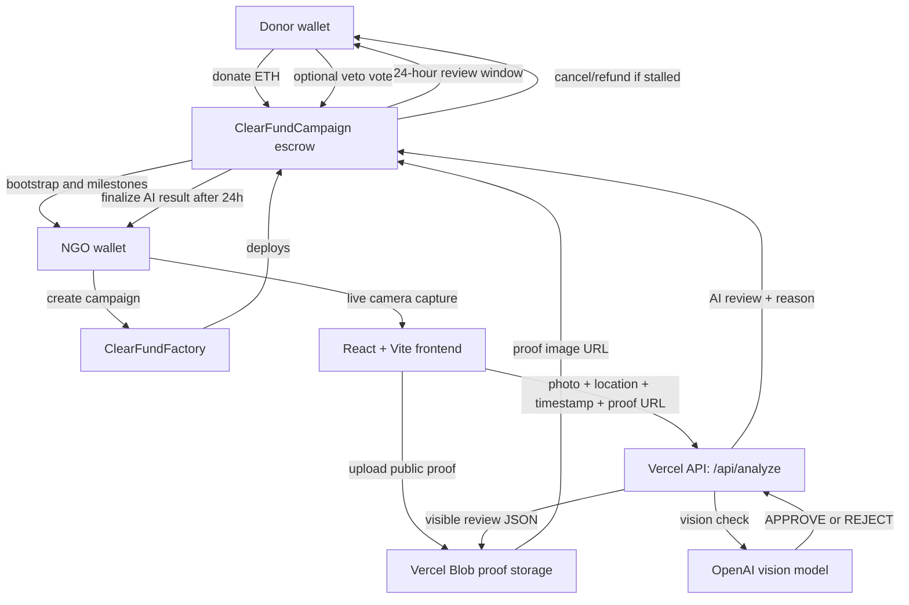

# ClearFund

ClearFund is a milestone-based donation escrow app on Ethereum Sepolia.
Donors fund NGO campaigns, but funds do not go straight to the NGO. ETH stays
inside a campaign smart contract and is released in stages only after milestone
evidence is submitted, checked by an AI oracle, and survives a 24-hour donor
review window.

The goal is simple: make donations accountable without forcing donors to vote
on every small step.

## What ClearFund Solves

Traditional donation platforms ask donors to trust that money will be used
properly. ClearFund moves that trust into a transparent workflow:

- Donations are held in on-chain escrow.
- NGOs receive only a small bootstrap release when the campaign starts.
- Remaining funds unlock milestone by milestone.
- Milestone evidence must come from live camera capture and browser location.
- The AI oracle gives a visible first-pass approval or rejection with reasoning.
- Donors get a 24-hour review window before the AI result becomes final.
- If the NGO misses a milestone deadline, donors can cancel and claim refunds
  from the remaining escrow.

## Core Features

| Feature | How it works |
| --- | --- |
| On-chain escrow | Every campaign is its own smart contract holding donated ETH. |
| Milestone payouts | Funds are split across NGO-defined milestones. |
| Bootstrap release | A 1-15% bootstrap tranche is released when fundraising passes the start threshold. |
| Live evidence | NGOs must capture evidence through the browser camera. No file upload field is exposed. |
| Public proof record | The captured JPEG, capture time, GPS location, and AI review data are stored for donor review. |
| Location permission | Browser geolocation is requested during evidence capture. No manual location input is used. |
| AI oracle | The Vercel API route sends the live photo, location, and milestone text to OpenAI, then stores the visible AI recommendation and explanation. |
| Donor veto | Donors can vote no during the 24-hour review window. Non-voters accept the AI recommendation when the window ends. |
| Majority rule | A milestone is rejected only if veto votes become a strict donor majority. |
| Refund path | If the campaign is cancelled or fundraising fails, donors can claim proportional refunds from the remaining balance. |
| RainbowKit wallet support | Wallet connection uses RainbowKit dark mode for browser, Safari, and mobile wallet flows. |

## Product Flow

1. NGO creates a campaign with a title, description, fundraising goal, campaign
   deadline, bootstrap percent, and 2-5 milestones.
2. Donors connect a wallet and donate ETH on Sepolia.
3. When the bootstrap threshold is reached, the NGO starts the campaign.
4. The campaign contract releases the bootstrap tranche to the NGO.
5. For each milestone, the NGO opens the live camera, allows location access,
   captures a fresh photo, and submits the milestone on-chain.
6. The frontend uploads the live JPEG and public proof metadata, then writes the
   proof URL on-chain with `submitMilestone`.
7. The frontend sends the photo, GPS location, capture timestamp, proof URL,
   campaign address, and milestone id to `frontend/api/analyze.js`.
8. The oracle checks that the campaign is registered, rejects stale evidence,
   asks the model for an `APPROVE` or `REJECT`, and stores what the AI saw plus
   why it recommended that outcome.
9. Approval and rejection both enter the same 24-hour donor review window.
10. Donors may vote no by calling `vetoMilestone`; doing nothing accepts the AI
   recommendation.
11. After 24 hours, anyone can call `executeMilestone` to finalize the review.
12. If no strict donor majority voted no, the AI recommendation becomes final:
    approval releases funds, rejection keeps funds locked for resubmission.
13. If a strict majority voted no, the milestone is rejected. The NGO may
    resubmit before the deadline. If the deadline is missed, donors can cancel
    and refund the remaining escrow.

## Architecture



## Folder Structure

The repo is intentionally small. There are only two main folders:

```txt
ClearFund/
  contracts/
    ClearFundCampaign.sol
    ClearFundFactory.sol

  frontend/
    api/analyze.js
    assets/
    components/
    blockchain.ts
    index.css
    index.html
    main.tsx
    package.json
    tsconfig.json
    vercel.json
    vite.config.ts
```

No build output, test files, generated folders, private keys, or `.env` files
belong in the public repo.

## Smart Contracts

### `ClearFundFactory.sol`

The factory deploys campaigns and keeps the campaign registry.

Main responsibilities:

- Store the oracle wallet address.
- Validate campaign inputs.
- Deploy `ClearFundCampaign`.
- Track all deployed campaign addresses.
- Track campaigns created by each NGO wallet.

### `ClearFundCampaign.sol`

Each campaign contract holds the donated ETH and controls the lifecycle.

Campaign states:

```txt
Fundraising -> Active -> Completed
                  |
                  v
              Cancelled
```

Milestone states:

```txt
Pending -> Submitted -> 24h Review -> Approved
                              |
                              v
                           Rejected
```

Important contract actions:

| Function | Caller | Purpose |
| --- | --- | --- |
| `donate()` | Donor | Sends ETH into escrow. |
| `startCampaign()` | NGO | Starts the campaign and releases bootstrap funds. |
| `submitMilestone()` | NGO | Records evidence metadata and marks the milestone submitted. |
| `oracleReviewMilestone()` | Oracle wallet | Stores the AI recommendation and opens the 24-hour review window. |
| `oracleApproveMilestone()` | Oracle wallet | Legacy helper for approval review. |
| `oracleRejectMilestone()` | Oracle wallet | Legacy helper for rejection review. |
| `vetoMilestone()` | Donor | Casts a no vote during the review window. |
| `executeMilestone()` | Anyone | Finalizes the AI result after 24 hours. Approval releases funds; rejection locks the milestone for resubmission. |
| `cancelStalledCampaign()` | Anyone | Cancels when the active milestone deadline is missed. |
| `refund()` | Donor | Claims the donor's share of remaining escrow after cancellation/fundraising failure. |

## Veto Rule

The veto system is intentionally low-friction:

- Donors only act when they disagree with the AI recommendation.
- Not voting accepts the AI recommendation after the 24-hour window.
- A donor override happens only when veto votes become a strict majority of donors.
- If no majority veto happens, the AI recommendation becomes final.
- If a majority veto happens, funds stay locked and the NGO must resubmit before
  the milestone deadline.

## Evidence Verification

The frontend does not expose file upload or manual location fields for milestone
evidence. The intended evidence flow is:

1. NGO clicks `Open Live Camera`.
2. Browser asks for location permission and camera permission.
3. The app shows a live camera preview.
4. NGO captures a JPEG frame from the live stream.
5. The app uploads the JPEG to proof storage and writes the public image URL
   into the milestone submission on-chain.
6. The app sends the JPEG, browser location, timestamp, and proof URL to the
   oracle.
7. The oracle rejects stale captures before calling the model.
8. Donors can see the proof image, capture time, GPS location, AI decision, and
   AI analysis before voting.

Important security note: browser camera and geolocation reduce lazy fraud, but
they are not perfect proof of reality. That is why ClearFund keeps the donor
review window as a human layer after every AI recommendation.

## Deployment Addresses

Deployment addresses are not hardcoded in the public source. Put the active
factory and any read-only legacy factories in the ignored root `.env` file for
local work, and in Vercel environment variables for production.

```txt
VITE_FACTORY_ADDRESS=current_factory_address
VITE_FACTORY_ADDRESSES=optional_read_only_legacy_factory_addresses
VITE_BLOCKED_FACTORY_ADDRESSES=optional_incompatible_factory_addresses
VITE_SUPERSEDED_FACTORY_ADDRESSES=optional_old_factories_not_for_new_campaigns
```

Existing deployed contracts cannot be changed by pushing new source code. Any
new contract logic, such as updated veto guards, requires redeploying the
factory and using the new factory address.

## Local Development

```bash
cd frontend
npm install
npm run dev
```

Build:

```bash
npm run build
```

Type check:

```bash
npm exec tsc -- --noEmit
```

## Environment Variables

Client-side variables:

```txt
VITE_WALLETCONNECT_PROJECT_ID=your_reown_or_walletconnect_project_id
VITE_FACTORY_ADDRESS=current_factory_address
VITE_FACTORY_ADDRESSES=optional_read_only_legacy_factory_addresses
VITE_BLOCKED_FACTORY_ADDRESSES=optional_incompatible_factory_addresses
VITE_SUPERSEDED_FACTORY_ADDRESSES=optional_old_factories_not_for_new_campaigns
VITE_SEPOLIA_RPC_URL=public_sepolia_rpc_url
VITE_BLOCK_EXPLORER_URL=sepolia_block_explorer_url
```

Server-side variables for `frontend/api/analyze.js`:

```txt
OPENAI_API_KEY=your_openai_key
AI_MODEL=openai_vision_model_name
PRIVATE_KEY=oracle_wallet_private_key
SEPOLIA_RPC_URL=server_sepolia_rpc_url
BLOB_READ_WRITE_TOKEN=vercel_blob_token_for_public_proof_images
```

The oracle API reuses the public `VITE_FACTORY_*` address variables so the same
factory list does not need to be duplicated as server-only env.


## License

MIT. Built by [Arav Arun](https://aravarun.xyz).
