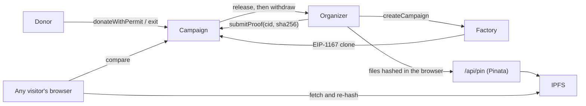

# ClearFund

ClearFund is a milestone escrow for social causes. A community kitchen, a school or a flood-relief group raises money in USDC,
and the money reaches them one milestone at a time, after they post photos and receipts.
Every release waits out a 72-hour window in which **any donor can walk away with their unspent share**.
Whoever stays pays for the work.

[Live app](https://clearfund.aravarun.in) · Sepolia testnet

## Why no vote

Most milestone-escrow designs let donors vote to block a payout. Any stake-weighted vote can be beaten by
whoever has more stake:

- the organizer backs their own campaign through other wallets, so honest donors can never reach the threshold;
- a whale or a rival funds a large share, then blocks payouts to kill the campaign;
- votes can be bought, borrowed with a flash loan or split across sybil wallets.

ClearFund replaces the vote with an **exit right**, the ragequit pattern from Moloch DAOs. One donor cannot vote to redirect another donor’s allocation. Each donor must still review on time; inactivity allows release.

## How a donation moves

1. **Give.** A donor sends USDC with one signature (EIP-2612 permit). It goes into an escrow made for that cause
   alone. If the campaign misses its minimum by the funding deadline, everyone takes back their full gift.
2. **Show the work.** When a milestone is done, the organizer uploads photos and receipts. Their browser hashes every
   file, pins them to IPFS and commits one sha256 for the whole proof on-chain. A milestone takes proof exactly once.
3. **Decide.** For 72 hours donors can look at the proof, which their browser re-checks against the on-chain hash,
   and anyone unconvinced can `exit()` with their unspent share.
4. **Release.** When the window closes, anyone can `release()` that milestone's share of the money still in.
   The organizer withdraws it. If a deadline passes without proof, anyone can `cancel()` and every donor takes
   back what is left.

The accounting is one number: `releasedBps`, the share of every remaining contribution already spent. A donor's
claim is always `contribution × (1 − releasedBps)`, so one donor's exit never changes another donor's claim.

## Campaign rules

These rules apply to campaigns created from the current (V2) factory, which the app uses for every new campaign.
Campaigns created earlier, including the three live demo campaigns, stay on the original immutable factory below and keep
its simpler rules: no funding-stage withdrawals, no payout caps and no schedule bounds. No balance or campaign is migrated.

- Funding lasts at most 30 days, and donors can reclaim their full commitment at any time during funding.
- The first payout is at most 25%, later payouts at most 75%, with two to four milestones totaling 100%.
- First proof is due 8–30 days after funding closes. Later proof deadlines are 5–30 days apart: this reserves
  72 hours of review, one day to release and at least one day for the next stage. The whole schedule is bounded to 180 days.
- After a missed work deadline, or if nobody releases within one day after review closes, a donor can exit and
  cancel the stalled campaign in the same transaction. At the exact review-end timestamp exits are still open;
  release opens one second later.
- **Silence permits payment.** Donors must review within 72 hours even when evidence is missing or misleading.
  Calendar reminders are optional downloads, not a guaranteed notification service.
- Only the creator **wallet** is barred from donating. A second wallet may belong to the same person, so raised totals
  and wallet counts are not proof of independent support. There is no voting power to capture.
- Hashes establish file integrity and document context, not truthful work or photo freshness. A new document can reuse old photos.
- This is reimbursement: organizers need upfront capital. Exits reduce later budgets; an organizer must cancel if the
  remaining money cannot finance the plan. There is no guarantee of a fully funded later stage.

Shared campaign links are authenticated against configured factories before showing money actions or requesting approval/signatures.
Discovery uses bounded pages and three concurrent campaign reads; one bad record does not hide the others.

Uploads require a wallet signature bound to the exact bytes, host, factory, purpose and expiry. Proof uploads also require the
registered campaign's current organizer. Persistent atomic Blob reservations enforce nonce replay protection and limits of
12 uploads per wallet/day, 24 per IP/day, 60 globally/day and 500 lifetime attempts, at most 3 MB each. Failed requests can consume
reservations; the service deliberately fails closed when storage or a budget is unavailable. Eight slot probes may reject early
near capacity. The lifetime ceiling bounds pinned uploads to at most 1.5 GB; raising/resetting it is an operator decision.

## Threat model

| Attack | What stops it |
| --- | --- |
| Organizer funds their own campaign through sock-puppet wallets to neutralize objections | There is no vote; an honest donor can always exit with their full unspent share |
| A whale funds most of a campaign, then exits or stays silent to manipulate others | A donor's claim depends only on their own contribution and `releasedBps` |
| Vote buying, flash-loaned stake, sybil wallets | Nothing to buy: no votes, and donations close when the work begins |
| Swapping proof after donors have seen it | One immutable proof per milestone; files are pinned by hash |
| A gateway or pinning service serving altered files | The browser re-hashes the document and every file against the on-chain hash |
| Replaying an old proof on another milestone or campaign | The proof document names its campaign and milestone, and is checked |
| Releasing before donors had their full window | Exits close at `reviewEndsAt`, releases open one second later |
| Organizer disappears | A missed deadline lets anyone cancel; unspent money goes back pro rata |
| USDC freezes the organizer's address | Pull payments: a frozen organizer only loses their own withdrawal |
| A front-run permit used to block a donation | `permit` failures are ignored when the allowance is already in place |
| USDC ever adds a transfer fee | Donations are booked by measured balance change, or refused |
| An admin key changes the rules | There is none: no owner, no pause, no upgrade; clones are initialized once |

## Architecture



| Piece | File | Notes |
| --- | --- | --- |
| Legacy escrow | `contracts/Campaign.sol` | Existing immutable rules. |
| V2 escrow | `contracts/CampaignV2.sol` | Bounded schedules, payout caps and funding exits. |
| Factories | `contracts/CampaignFactory.sol`, `contracts/CampaignFactoryV2.sol` | Independent immutable versions; V2 adds paged registry reads. |
| Proof format | `frontend/src/proof.ts` | Builds and verifies hashed proof documents, in the browser. |
| Pin route | `frontend/api/pin.js` | Holds the Pinata key. A convenience, not a source of trust. |
| App | `frontend/src/` | React, wagmi, RainbowKit, ethers. |

## Deployments on Sepolia

Current factory: [`0x89C2e6BeF47DeA102Aa0aeFD8140406A10a0E3D3`](https://repo.sourcify.dev/11155111/0x89C2e6BeF47DeA102Aa0aeFD8140406A10a0E3D3).
Implementation: [`0xC8f3C5280cFf35b9B7351FAa37528965052255f9`](https://repo.sourcify.dev/11155111/0xC8f3C5280cFf35b9B7351FAa37528965052255f9).
Both have exact-match verification on Sourcify. Created in block 12118906 by
[this transaction](https://sepolia.etherscan.io/tx/0xabdc5e5b64c97cd273c325b5b4e9f704ce420ad13d08442c5f6f1c83b6e08f42).

Earlier factory (existing campaigns keep their original rules):

| Contract | Address |
| --- | --- |
| CampaignFactory | [`0x552FBAA13FFed95eF4741f028559bEF092ddFf2A`](https://sepolia.etherscan.io/address/0x552FBAA13FFed95eF4741f028559bEF092ddFf2A) |
| Campaign implementation | [`0x30C7c2840aC4716A1c1C8ca5C593bCd30d376F5B`](https://sepolia.etherscan.io/address/0x30C7c2840aC4716A1c1C8ca5C593bCd30d376F5B) |
| USDC (Circle) | [`0x1c7D4B196Cb0C7B01d743Fbc6116a902379C7238`](https://sepolia.etherscan.io/address/0x1c7D4B196Cb0C7B01d743Fbc6116a902379C7238) |

Both ClearFund contracts are verified on Sourcify with an exact bytecode match.

## Run it

From the repository root:

```bash
cd frontend && npm ci && npm run dev        # the app, on http://localhost:5173
```

The contracts are in `contracts/`. Build them with [Foundry](https://getfoundry.sh):

```bash
cd contracts && forge build
```

Deploy a factory. It creates its own escrow implementation:

```bash
cd contracts
forge create CampaignFactoryV2.sol:CampaignFactoryV2 --constructor-args 0x1c7D4B196Cb0C7B01d743Fbc6116a902379C7238 \
  --rpc-url $SEPOLIA_RPC_URL --account clearfund-deployer --broadcast
```

Environment (a `.env` file at the repository root for local runs, or the Vercel project settings):

| Variable | Purpose |
| --- | --- |
| `VITE_FACTORY_ADDRESS`, `VITE_FACTORY_DEPLOY_BLOCK` | The factory, and where its event history starts |
| `VITE_FACTORY_V2_ADDRESS`, `VITE_FACTORY_V2_DEPLOY_BLOCK` | New verified factory and creation block; enables V2 creation |
| `BLOB_READ_WRITE_TOKEN` | Server only: durable upload quota storage (public Blob store by default) |
| `UPLOAD_QUOTA_BLOB_ACCESS` | Set `private` only for a private Blob store |
| `VITE_USDC_ADDRESS` | Circle's Sepolia USDC by default |
| `VITE_SEPOLIA_RPC_URL` | Read RPC; a public endpoint is used as a fallback |
| `VITE_IPFS_GATEWAY` | Where proofs are fetched from. Defaults to `https://gateway.pinata.cloud/ipfs/`; a dedicated gateway is faster |
| `VITE_WALLETCONNECT_PROJECT_ID` | Wallet connections |
| `PINATA_JWT` | Server only: the key the pin route uses |

Test USDC is free at [faucet.circle.com](https://faucet.circle.com).

USDC's issuer can block the escrow or a donor, preventing transfers. A frozen organizer alone does not block other users,
but that does not remove token-issuer control. RPC, gateway, pinning and frontend hosting can be unavailable; the contracts
have no owner, pause or upgrade key. This is a testnet demo and not an independent security-audit claim.

## License

MIT. Built by [Arav Arun](https://aravarun.in).
